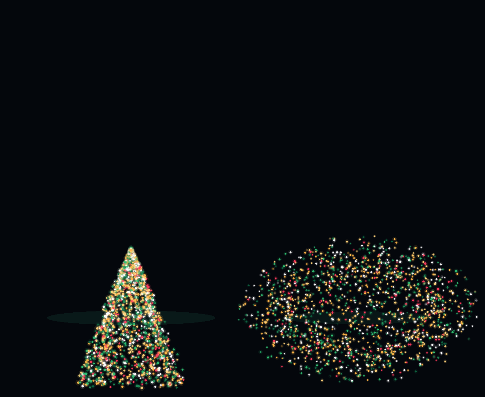
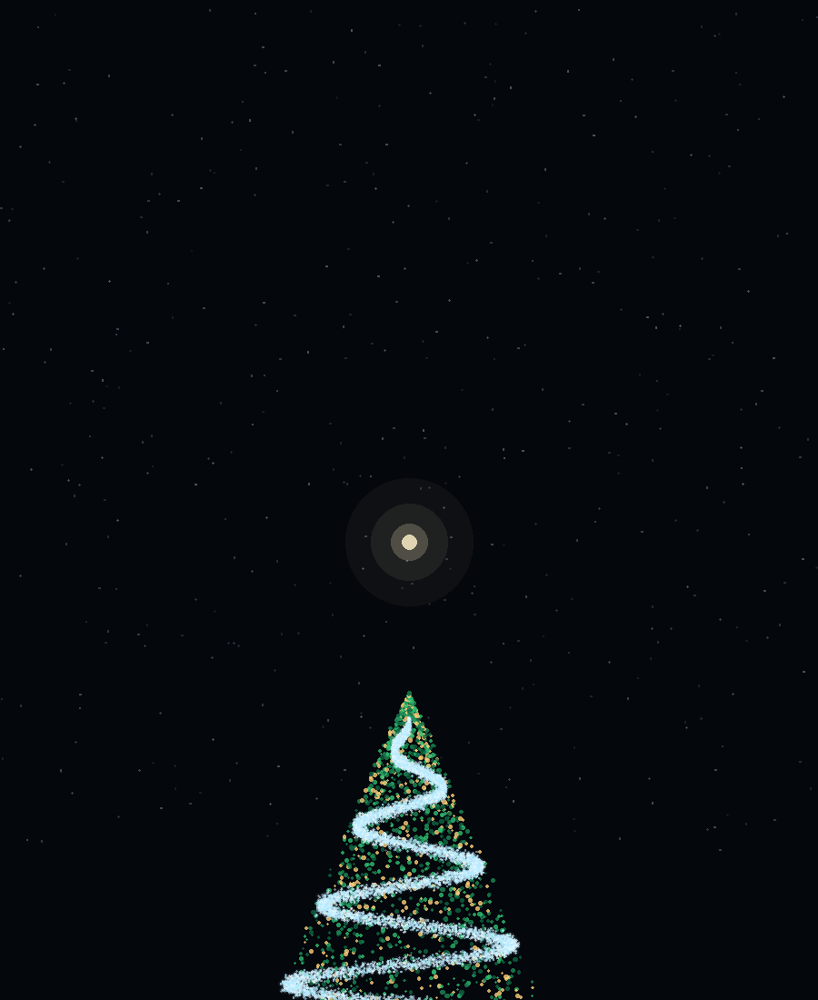

# HOLO TREE · 手势圣诞树（自研版）

**在线版（GitHub Pages，永久）：<https://thtdh007.github.io/THTdh007/>**

一棵用手比划就能操控的 3D 粒子圣诞树。**代码是自己的**，不是从任何人那里改的副本：
three.js 场景、手势识别、操控手感、UI 全部按我们的需求重写，注释和可调参数都留着。



> ⚠️ 上面这张图是用 `js/layout.js` 里**真实的粒子坐标**离线渲染的（验证形状用），
> 不是浏览器截图。真机效果还有辉光、雪、金属相框和照片云。

---

## 先跑起来

摄像头只能在 `localhost` 或 `https` 下启用，所以别双击 HTML，起个静态服务：

```bash
cd ~/Documents/deepseek-harness/default-workspace/xmas-tree-holo
python3 -m http.server 8767
```

打开 <http://127.0.0.1:8767/> → 允许摄像头 → 把手放进画面。

**没有摄像头也能玩**：鼠标拖拽转、滚轮缩放、空格撒花、`1` / `2` 切形态，`R` 重播开场。

---

## 手势

| 手势 | 效果 | 稳定性设计 |
| :-- | :-- | :-- |
| 🖐 把手放到画面**左/右侧**（保持 0.12 秒） | **锁定转向**：场景沿该方向持续转，手移开也不停 | 方向要稳定 0.12 秒才生效，快速扫过不算 |
| 🖐 手回到**画面中心**（稳住 0.8 秒） | 停止转向，回落为自然自转 | 中心 ±18% 是停止区 |
| 🖐 手掌上下移动 | 俯仰 ±17°（实时跟随） | 与转向互不干扰 |
| 📏 手靠近 / 远离镜头 | 相机拉近 / 拉远 | 用「手掌尺度」比值判断，不看绝对值 |
| ✋ 五指张开（保持 0.3 秒） | 散开成星云 | 滞回 + 保持时长，防单帧误判乱跳 |
| ✊ 握拳（保持 0.3 秒） | 收拢成圣诞树 | 同上 |
| 👌 拇指食指捏合 | 指着相框 → **全屏展开照片**；没指到相框 → 撒一把金粒子 | 双阈值滞回 |
| 👆 点相框（鼠标/手指） | 同样展开照片，再点一下关闭；点空白处也可关闭 | 14px 手指容差、单指短按 |
| 1️⃣ 比 1 → 2 → 3 → 五指张开 | 树身粒子散开并重组为左侧 HUD「文字」框里的字；文字自动铺满屏幕 86% 宽 | 每步稳定 130ms，序列 4s 内有效；触发后 3s 锁定，之后点一下/捏合收起 |
| ✏️ 照片下方文字 | 聚焦照片后，底部输入框可写一句话（最多 30 字、3 行内），边打边显示在相框下 | 存在 `node.userData.caption`，仅本次会话有效 |
| ＋ 加照片（右上角） | 换成自己的照片，可一次选多张；最多 9 张 | `CONFIG.photos.max` |

### 交互模型的变更（v1.1）

原来是「实时跟随」：视角随手同步转，手停即停 —— 手一放下画面就僵住，长时间看着很别扭。

现在改成 **判向 + 持续旋转**：

- 手势只负责**决定方向**，锁定后场景自己按 0.62 rad/s（约 35°/s）持续转；
- 手移开镜头也继续转，不再需要"举着手保持"；
- 手回中心停 0.8 秒，或朝反方向比一下，才会改变/停止；
- 没有方向时保持自然自转，速度按需求从 0.16 提到 **0.208（×1.3）**。

配置项：`steerEnter` / `steerHold` / `steerSpeed` / `centerStop` / `centerStopTime`。

### 装饰：礼盒 + 蝴蝶结（v1.3）

装饰**不是实体模型**，而是用和树身完全相同的粒子（同一个 `geometry` + 同一个 `material`）
拼出的形状 —— 所以光泽、粒度、材质都和主体一致，不会像贴上去的道具。

| 项 | 取值 |
| :-- | :-- |
| 礼盒 | 5 个，中下段，约 515 颗粒子/个 |
| 蝴蝶结 | 3 个，中上段，外扩树身 1.32 倍，约 152 颗粒子/个 |
| 粒子材质 | 复用 `this.particles` 的 geometry/material，颜色取主体调色板（绿/金/红） |
| 合拢 | 粒子拼回礼盒/蝴蝶结的形状 |
| 散开 | 粒子各自飞向球壳随机点，和树身粒子同一套缓动，自然散成星尘 |
| 回位 | 沿同一路径重新拼回形状 |

形状采样在 `js/ornament-shapes.js`（纯函数）：盒身六面采样、盒盖、沿中线的十字丝带、
两个压扁的环 + 结心 + 飘带组成蝴蝶结。摆放算法在 `js/ornament-math.js`。

数量克制是刻意的：礼盒 ≤6、蝴蝶结 ≤5，测试会拦（多了显廉价）。

### 环绕光带（v1.2）



一条从树底盘到树顶的螺旋粒子丝带，参数完全按 `01-环绕光带-提示词.md` 实现：

| 项 | 取值 |
| :-- | :-- |
| 圈数 | 3.8 圈（规格 3.5–4） |
| 半径 | 该高度树身半径 × 1.1（跟着锥形收分，**不写死绝对值**） |
| 终点 | 树顶下方 8% |
| 粒子数 | 9000（手机自动降到 5000） |
| 带宽 | 树高 4%，横向抖动 ±3% |
| 颜色 | 冰蓝 `#A8E6FF` → 白 |
| 自转 | 0.12 rad/s |
| 流动 | 沿螺旋向上，4 秒/圈 |
| 空间感 | 转到树后侧亮度衰减 40% |

实现要点：

- **单 draw call**：一条 `BufferGeometry` + `Points`，位置、颜色、亮度全部在顶点/片元着色器里按 `uTime` 计算，**每帧不重建几何体**。
- **不穿模**：半径用的是 `ribbon-math.js` 里与 `layout.js` 同一份收分公式，树缩放时同步跟着变。
- **有前后层次**：着色器里用「粒子相对树心」和「粒子朝向相机」点乘判断在树前还是树后，暗 40%，避免加色混合下整条带子浮在树前面。
- **散开态淡出**：切到粒子爆散时丝带透明度衰减到 0，不会和爆散的粒子糊在一起。

调色只需改 `config.js` 里的 `ribbon.colorA/colorB`（想跟主体融合可改成香槟金 `0xffd9a0`）。

### 相框互动

- 手指（或鼠标）指到相框上时，相框会放大 12% 作为反馈；
- **捏合**（或鼠标轻点）→ 照片全屏展开；
- 展开时用**独立 DOM 浮层**，不接管渲染循环 —— 圣诞树在背后照常旋转、雪照常落；
- 点任意处 / 按 Esc / 点右上角关闭。

参数全在 [`js/config.js`](js/config.js)，改阈值立刻生效，不用碰逻辑。

按 `D` 打开调试面板，能看到实时的**张开度 / 捏合比 / 手掌尺度**，以及对应的阈值：

```
手势识别 24 fps
张开度 1.83  (张开>1.6 / 握拳<1.15)
捏合比 0.42  (捏合<0.35)
手掌尺度 0.127
yaw 0.41  pitch -0.08  zoom 0.86
```

识别不灵敏的时候，看这里就知道是"手没识别到"还是"阈值不合适"——这是上一版最缺的东西。

---

## 目录

```
index.html            页面骨架 + importmap（three 指向本地 vendor）
css/app.css           全部样式，无框架
js/main.js            入口：串场景 / 手势 / UI，主循环
js/tree.js            three.js 场景：粒子树、装饰、照片云、雪、辉光
js/gesture.js         纯逻辑：21 关键点 → 手势量 + 识别器（含滞回/去抖）
js/controls.js        纯逻辑：手势量 → 平滑的 yaw/pitch/缩放
js/layout.js          纯逻辑：粒子在两种形态下的目标坐标
js/hands.js           MediaPipe 封装（本地模型优先，CDN 兜底）
js/config.js          所有可调参数
tests/                node 单测（17 项，不需要浏览器）
vendor/               three.js、MediaPipe 的本地副本
tools/                vendor 拉取脚本、静态校验脚本
```

**为什么这样拆**：`gesture / controls / layout` 三个文件不碰 DOM、不碰 three.js，
所以能直接跑单测。上一版最大的问题就是"手感逻辑和渲染糊在一起，改一行全靠猜"。

---

## 测试

```bash
node --test tests/*.test.mjs
```

覆盖的都是容易出错、且肉眼难发现的地方：

- 镜像方向（手往右移，坐标应该变大）
- 捏合/张开的滞回与保持时长
- 树在画面中心不抖（死区）
- 手进入画面时不会瞬移（偏移补偿）
- 60fps 与 20fps 下手感一致（与帧率无关的平滑）
- 粒子布局确实是圆锥、不穿地、散开态不挤成一坨

静态校验（导入路径、DOM id、资源文件是否齐全）：

```bash
node tools/verify.mjs
```

---

## 调手感

改 [`js/config.js`](js/config.js)：

| 想改什么 | 改哪个 |
| :-- | :-- |
| 左右转得不够多 | `rig.yawRange`（弧度，1.15 ≈ 66°） |
| 跟手太慢 / 太飘 | `rig.follow`（5.5 挺合适，8 以上开始抖） |
| 手放中间还是轻微晃 | `rig.deadzone` 调大 |
| 缩放太猛 | `rig.zoomNear` / `zoomFar` 拉近一点 |
| 张开/握拳不灵 | `gesture.openOn` / `fistOn`（先按 D 看实际数值再定） |
| 显示器掉帧 | `particles.count` 降到 900，或 `quality.maxPixelRatio` 改 1.5 |

---

## 部署到公网

摄像头要求 **https**（localhost 例外）。当前已经部署在 **GitHub Pages**（`docs/` 作为发布源），
推送 `main` 后 Pages 会自动重新发布。也可以换别的静态托管：

- **Netlify**：把整个文件夹拖到 <https://app.netlify.com/drop>
- **Vercel** / **Cloudflare Pages**：直接连目录，无需构建命令
- 自己的服务器：Nginx 指向目录即可，确保 `vendor/` 一起上传（20MB 左右）
  或者改用 CDN：删掉 `vendor/` 后，`js/hands.js` 会自动回退到 jsdelivr。

`.task` 模型文件需要正确的 MIME（一般是 `application/octet-stream`），
Nginx 默认就够用；如果手势加载报错，先看 Network 里这个文件的响应码。

---

## 授权与商用

本作品按「卖成品」授权：购买后可部署、可改、可自用；不可转售源码、
不可作为模板再分发。完整条款见 [`LICENSE`](LICENSE)。

## 依赖与许可

代码是我们自己的，没有拷贝任何第三方项目。依赖两个开源库：

| 库 | 版本 | 许可 | 用途 |
| :-- | :-- | :-- | :-- |
| [three.js](https://threejs.org) | 0.160.0 | MIT | 3D 渲染 |
| [MediaPipe Tasks Vision](https://developers.google.com/mediapipe) | 0.10.3 | Apache-2.0 | 手部 21 关键点 |

细节见 [`THIRD_PARTY.md`](THIRD_PARTY.md)。两个许可都允许商用，保留声明即可。

---

## 已知限制

- **手势阈值是通用值**，手特别小/特别远、或者光线很差时可能需要调 `openOn` / `fistOn`。
  按 `D` 看到真实数值再定，比盲调快得多。
- **摄像头画质差**时 MediaPipe 会掉到 10fps 左右，手会有点延迟——这是识别器的问题，
  不是渲染的。可以在 `js/hands.js` 里把 `width/height` 调到 480×360 换速度。
- **Safari 首次授权**后如果画面全黑，刷新一次即可（Safari 的老毛病）。
- 当前是单人演示，`numHands: 1`；要双手玩得改 `hands.js` 和 `main.js` 的单手假设。

---

## 单文件版（双击就能看，手机也能玩）

```bash
node tools/bundle.mjs        # 重新生成
```

产物：`docs/index.html`（约 1.3MB）。这个目录同时也是 GitHub Pages 的发布源。

这个文件把 three.js、插件、我们的全部代码和 CSS 都内联进去了：
**没有任何外部请求**，断网、双击、发微信、AirDrop 给谁都能打开。

### 各端的操作

| 场景 | 怎么玩 |
| :-- | :-- |
| 电脑双击打开 | 鼠标拖拽转、滚轮缩放、双击切换形态、空格撒花、`R` 或右上「↻ 重播」重播开场 |
| 手机打开（本地文件） | 单指拖拽转、双指捏合缩放、双击切换、点「📱 倾斜控制」用陀螺仪、点右上「↻ 重播」重播开场、点「◎ 调试」看帧率与手势数值 |
| https 托管后 | 摄像头手势自动接管（张开/握拳/捏合/移动手掌） |

### 关于手机摄像头

浏览器规定摄像头只在 **https 或 localhost** 下可用，`file://` 一律拒绝，
没有任何前端技巧能绕过。所以单文件版在手机上默认走「手指 + 陀螺仪」，
这也刚好是手机最自然的操作方式。

要做回手势，把这个文件拖到 <https://app.netlify.com/drop> 换一个 https 地址即可
（单文件也能直接拖，不需要 `dist` 目录结构），手机会自动加载 MediaPipe 模型。

### 单文件版和完整版的关系

- 完整版（仓库根 `index.html` + `js/` + `vendor/`）：带摄像头手势，依赖都在本地，适合自己长期用/二次开发。
- `docs/index.html`：单文件成品，也是 Pages 发布的内容，改完源码用 `tools/sync-github.sh` 同步。
- 单文件版：同一套源码打包产物，零依赖，适合分享。
- 改完源码后跑一次 `node tools/bundle.mjs` 就能同步，不用手工改两遍。
